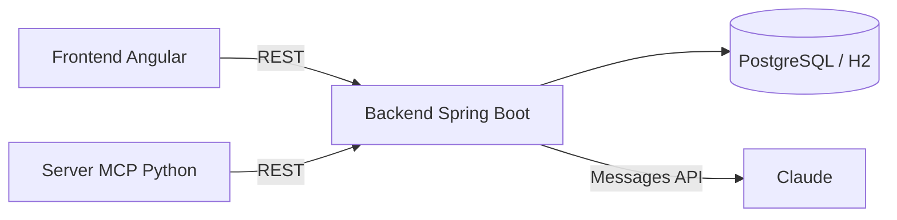

# Expense Assistant

Registra le tue spese scrivendole come le diresti, *"ieri 30€ di benzina"*, e fai
domande sui tuoi dati in linguaggio naturale. Claude trasforma le frasi in spese
strutturate tramite **tool use**, e un **server MCP** rende gli stessi dati disponibili
a Claude Desktop e Claude Code.

## Funzionalità

- **Inserimento a parole**: la frase diventa una bozza (descrizione, importo, categoria,
  data) da confermare o correggere prima del salvataggio.
- **Chat sulle spese**: "quanto ho speso in ristoranti a ottobre?" — Claude interroga i
  dati reali con un loop agentico di tool use.
- **Riepilogo mensile** per categoria ed elenco delle spese con filtri.
- **Server MCP** con tool, resource e prompt per usare le spese da qualsiasi client MCP.
- Funziona anche **senza chiave API**, con l'inserimento manuale.

## Architettura



| Cartella | Stack | Ruolo |
|----------|-------|-------|
| [`backend/`](backend/README.md) | Java 21, Spring Boot 3, JPA, Flyway | API REST, persistenza, integrazione con Claude |
| [`mcp-server/`](mcp-server/README.md) | Python 3.11+, SDK MCP 2.x | Espone le spese ai client MCP |
| [`frontend/`](frontend/README.md) | Angular 21 | Interfaccia web |

Le scelte di progetto sono spiegate in [docs/ARCHITETTURA.md](docs/ARCHITETTURA.md).

## Avvio rapido con Docker

```bash
cp .env.example .env        # inserisci ANTHROPIC_API_KEY (facoltativa)
docker compose up --build
```

- App: http://localhost:4200
- API: http://localhost:8080

## Sviluppo locale

```bash
# Backend (H2 su file, nessun database da installare)
cd backend && ANTHROPIC_API_KEY=sk-ant-... mvn spring-boot:run

# Frontend (con proxy verso il backend)
cd frontend && npm ci && npm start

# Server MCP
cd mcp-server && pip install -e ".[dev]"
claude mcp add expense-assistant -- "$(pwd)/.venv/bin/expense-mcp-server"
```

## Qualità

Ogni pull request passa dalla CI: test del backend (integrazione con H2, parser, loop
della chat, contratto HTTP), test del server MCP, test e build del frontend, formattazione
e build delle immagini Docker. Nessun test chiama l'API di Claude.

Le modifiche sono raccolte nel [CHANGELOG](CHANGELOG.md); le convenzioni del repository
sono in [CLAUDE.md](CLAUDE.md).

## Licenza

[MIT](LICENSE)
