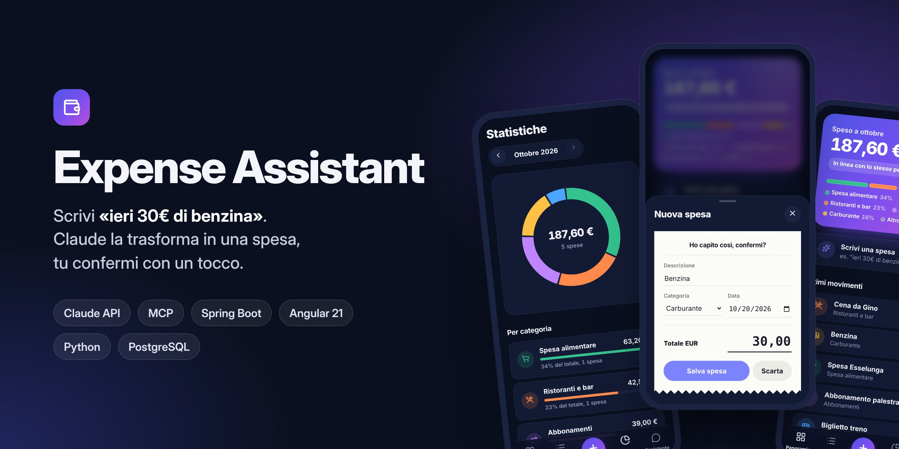
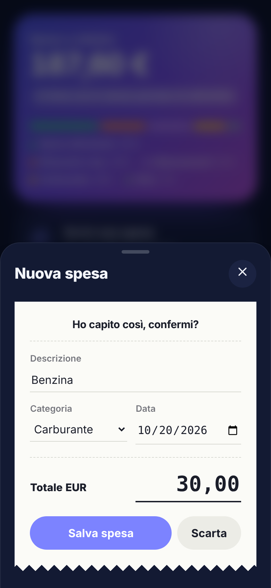
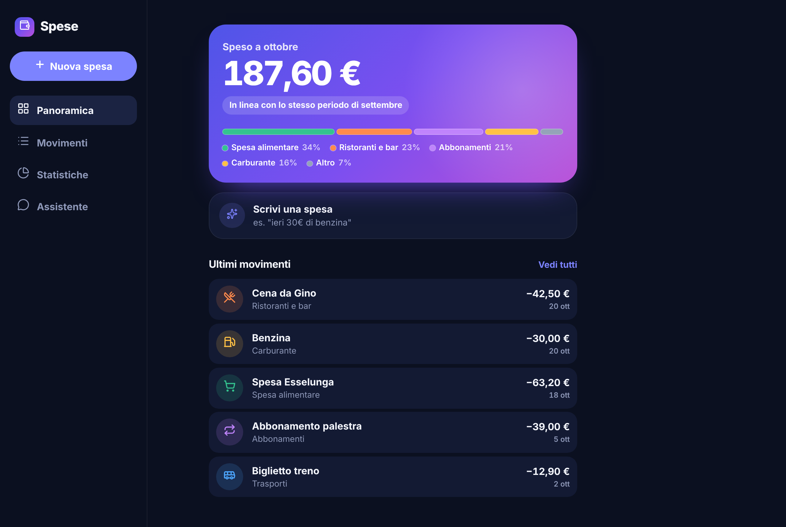
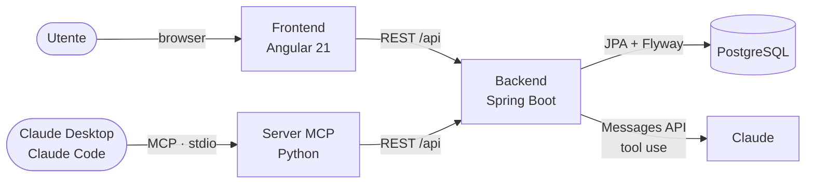
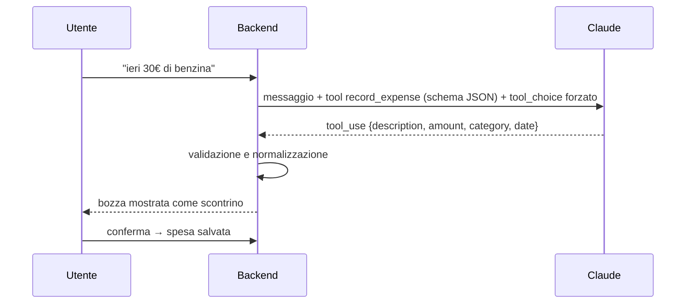

<p align="center">
  
</p>

<p align="center">
  <a href="https://github.com/imNayrb/expense-assistant/actions/workflows/ci.yml"></a>
  
  
  
  
  
  
</p>

<p align="center">
  <b>Un tracker delle spese che si usa scrivendo come si parla.</b><br />
  Scrivi <i>"ieri 30€ di benzina"</i>: Claude estrae importo, categoria e data, tu confermi.<br />
  Poi chiedi <i>"quanto ho speso in ristoranti a ottobre?"</i> e ottieni una risposta basata sui tuoi dati reali.
</p>

<p align="center">
  <a href="#cosa-fa">Cosa fa</a> ·
  <a href="#perché-lho-costruito">Perché</a> ·
  <a href="#come-funziona">Come funziona</a> ·
  <a href="#stack">Stack</a> ·
  <a href="#avvio-rapido">Avvio</a> ·
  <a href="#qualità-e-test">Test</a> ·
  <a href="docs/ARCHITETTURA.md">Architettura</a>
</p>

---

## Cosa fa

<table>
  <tr>
    <td width="36%" valign="top">
      
    </td>
    <td valign="top">

**Inserimento a parole**<br />
Una frase come *"pizza con gli amici 18,50"* diventa una spesa strutturata. Claude la
interpreta e la mostra come uno **scontrino da confermare**: l'AI propone, l'ultima parola
è sempre tua.

**Domande sulle tue spese**<br />
*"In cosa spendo di più?"*, *"che spese ho fatto la settimana scorsa?"*. L'assistente non
inventa: interroga i dati reali tramite tool e ti dice anche quali ha consultato.

**Panoramica e statistiche**<br />
Totale del mese con il confronto rispetto al mese precedente, ripartizione per categoria,
grafico a ciambella, movimenti raggruppati per giorno.

**Le tue spese dentro Claude**<br />
Un **server MCP** espone le stesse spese a Claude Desktop e Claude Code: puoi chiedere un
riepilogo direttamente dal client che usi già.

**Funziona anche senza AI**<br />
Senza chiave API l'app resta pienamente utilizzabile, con l'inserimento manuale.

  </td>
  </tr>
</table>

<p align="center">
  
  
  
  
</p>

<details>
<summary><b>Versione desktop</b></summary>
<br />
<p align="center"></p>
</details>

## Perché l'ho costruito

Ho seguito il percorso per sviluppatori dell'**[Anthropic Academy](https://anthropic.skilljar.com)**
e ne ho ottenuto gli attestati. Volevo però dimostrare di saper usare quei concetti in un
prodotto vero, non solo negli esercizi: un'applicazione completa, testata e
documentata, con un'interfaccia curata quanto il codice.

| Attestato | Cosa insegna | Dove l'ho applicato |
|-----------|--------------|---------------------|
| [**Building with the Claude API**](https://anthropic.skilljar.com/claude-with-the-anthropic-api) | Messages API, tool use, `tool_choice`, loop agentici, gestione degli errori | Parsing con tool forzato in [`ExpenseParser`](backend/src/main/java/com/imnayrb/expenseassistant/assistant/ExpenseParser.java), chat agentica in [`ChatAssistant`](backend/src/main/java/com/imnayrb/expenseassistant/assistant/ChatAssistant.java), client HTTP in [`AnthropicLlmClient`](backend/src/main/java/com/imnayrb/expenseassistant/assistant/llm/AnthropicLlmClient.java) |
| [**Introduction to Model Context Protocol**](https://anthropic.skilljar.com/introduction-to-model-context-protocol) | Server e client MCP, le tre primitive: tool, resource, prompt | [`mcp-server/`](mcp-server/src/expense_mcp/server.py): 4 tool, 2 resource e 1 prompt |
| [**Model Context Protocol: Advanced Topics**](https://anthropic.skilljar.com/model-context-protocol-advanced-topics) | Sampling, notifiche, accesso al file system, trasporti per la produzione | Trasporto stdio come per i client desktop, errori del backend resi leggibili al modello, test con client in-process e con il server avviato come sottoprocesso ([`tests/`](mcp-server/tests)) |

Il risultato è il progetto che porterei a un colloquio: ogni scelta è motivata in
[`docs/ARCHITETTURA.md`](docs/ARCHITETTURA.md).

## Come funziona



Il **backend è l'unica fonte di verità**: web app, server MCP e tool usati da Claude
passano tutti dalla stessa API, con la stessa validazione.

### Dalla frase alla spesa



- **Output strutturato garantito**: invece di chiedere "rispondi in JSON", Claude è
  obbligato a chiamare un tool il cui schema vincola categorie, formati e tipi.
- **Il modello non è mai l'ultima parola**: il backend ricontrolla ogni campo e l'utente
  conferma prima del salvataggio.
- **Le date relative funzionano**: il prompt contiene la data di oggi nel fuso
  `Europe/Rome`, così "ieri" o "lunedì scorso" vengono risolti correttamente.

### Le domande in chat

Un **loop agentico**: Claude riceve la domanda e la descrizione di tre tool
(`list_expenses`, `get_summary`, `add_expense`), chiede di eseguirli, il backend li esegue
con le proprie regole e gli restituisce i risultati, fino alla risposta finale. Il loop ha
un tetto di 5 giri, e gli errori dei tool tornano a Claude per farglieli spiegare invece
di far fallire la richiesta.

Flussi, scelte e compromessi nel dettaglio: [**docs/ARCHITETTURA.md**](docs/ARCHITETTURA.md)

## Stack

| Livello | Tecnologie | Punti di interesse |
|---------|------------|--------------------|
| **Backend** | Java 21, Spring Boot 3.5, Spring Data JPA, Flyway, PostgreSQL / H2 | Porta `LlmClient` per isolare Claude, errori RFC 9457, `BigDecimal` per gli importi |
| **AI** | Claude Messages API | Tool use forzato, loop agentico con limite di giri |
| **MCP** | Python, SDK MCP 2.x, httpx | Tool con annotations di sola lettura e distruttive, resource, prompt |
| **Frontend** | Angular 21 (standalone, signals, zoneless) | View Transitions, bottom sheet su `<dialog>`, swipe, animazioni solo su `transform`/`opacity` |
| **Infrastruttura** | Docker Compose, nginx, GitHub Actions | Stack completo con un comando, CI con test end-to-end |

## Avvio rapido

Serve solo Docker.

```bash
git clone https://github.com/imNayrb/expense-assistant.git
cd expense-assistant
cp .env.example .env            # inserisci ANTHROPIC_API_KEY (facoltativa)
docker compose up --build
```

| Servizio | Indirizzo |
|----------|-----------|
| App web | http://localhost:4200 |
| API REST | http://localhost:8080 |

<details>
<summary><b>Sviluppo locale senza Docker</b></summary>

```bash
# Backend (H2 su file, nessun database da installare)
cd backend
ANTHROPIC_API_KEY=sk-ant-... mvn spring-boot:run

# Frontend, con proxy verso il backend
cd frontend
npm ci && npm start
```
</details>

<details>
<summary><b>Collegare il server MCP a Claude Desktop o Claude Code</b></summary>

```bash
cd mcp-server
python -m venv .venv && source .venv/bin/activate
pip install -e .

# Claude Code
claude mcp add expense-assistant -e EXPENSE_API_URL=http://localhost:8080 -- \
  "$(pwd)/.venv/bin/expense-mcp-server"
```

Per Claude Desktop e per l'elenco completo di tool, resource e prompt vedi
[`mcp-server/README.md`](mcp-server/README.md).
</details>

## Qualità e test

Ogni pull request passa dalla CI, che esegue quattro job:

| Job | Cosa verifica |
|-----|---------------|
| **Backend** | 20 test JUnit: integrazione HTTP → JPA → H2 con lo schema Flyway reale, parser, loop agentico, contratto HTTP con l'API di Claude |
| **Server MCP** | 9 test pytest con backend finto e client MCP in-process; ruff per stile e formattazione |
| **Frontend** | 20 test Vitest (bottom sheet, eliminazione annullabile, importi, date, client API); Prettier; build di produzione |
| **End-to-end** | Stack completo con Docker Compose: PostgreSQL e migrazioni, API attraverso nginx, routing delle pagine, server MCP avviato via stdio contro il backend reale |

Nessun test chiama l'API di Claude: il modello è isolato dietro un'interfaccia e sostituito
da fake deterministici. I test sono quindi veloci, gratuiti e ripetibili.

Sul fronte della sicurezza, **CodeQL** analizza Java, Python, TypeScript e i workflow,
**Dependabot** aggiorna le dipendenze ogni settimana e le pull request che introducono
dipendenze vulnerabili vengono bloccate. Dettagli in [SECURITY.md](SECURITY.md).

## Struttura del repository

```
expense-assistant/
├── backend/        API REST Spring Boot e integrazione con Claude   → backend/README.md
├── mcp-server/     Server MCP in Python                             → mcp-server/README.md
├── frontend/       Web app Angular                                  → frontend/README.md
├── docs/           ARCHITETTURA.md e immagini
├── scripts/        Test end-to-end dello stack
├── .github/        CI, sicurezza, Dependabot, CODEOWNERS e modelli di PR e issue
├── CHANGELOG.md    Cronostoria delle modifiche
├── CLAUDE.md       Convenzioni del repository
├── CONTRIBUTING.md Come proporre modifiche
└── SECURITY.md     Politica di sicurezza
```

Il lavoro è organizzato in pull request piccole e tematiche, con
[Conventional Commits](https://www.conventionalcommits.org/it/) e un
[CHANGELOG](CHANGELOG.md) aggiornato a ogni modifica. Vuoi proporre qualcosa? Leggi
[CONTRIBUTING.md](CONTRIBUTING.md).

## Prossimi passi

- Autenticazione e spese per utente, per poterla pubblicare online.
- Budget mensili per categoria con avvisi.
- Import da estratto conto CSV, con categorizzazione fatta da Claude.
- Risposte della chat in streaming.

## Autore

**Bryan Uppolo**, Full Stack Developer e UX/UI.
[GitHub @imNayrb](https://github.com/imNayrb)

## Licenza

Distribuito con licenza [MIT](LICENSE).
