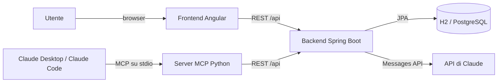
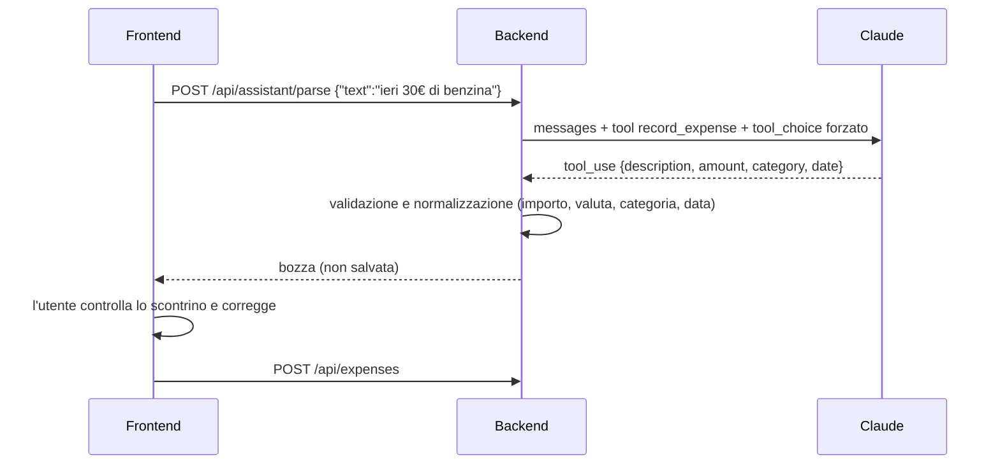
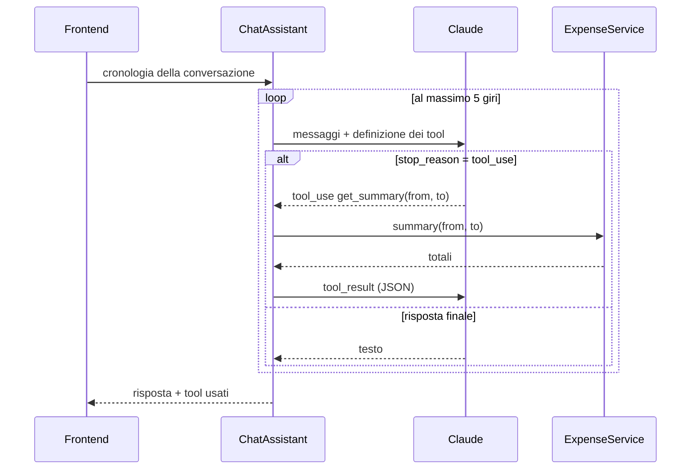

# Architettura di Expense Assistant

Questo documento spiega **come** è fatto il progetto e soprattutto **perché** è fatto
così. È pensato anche per prepararsi a raccontarlo: in fondo c'è una sezione di domande
tipiche da colloquio, con le risposte.

## 1. Il problema

Registrare le spese è noioso: aprire un'app, scegliere la categoria, digitare l'importo,
selezionare la data. L'idea è ridurre tutto a una frase, *"ieri 30€ di benzina"*, e
poter poi chiedere *"quanto ho speso in ristoranti a ottobre?"*.

Il linguaggio naturale lo gestisce Claude; tutto il resto (validazione, persistenza,
calcoli) resta codice tradizionale, verificabile e testato.

## 2. Vista d'insieme



| Componente | Responsabilità | Non fa |
|------------|----------------|--------|
| **Backend** | Unica fonte di verità: dati, validazione, regole, integrazione con Claude | Non conosce l'interfaccia |
| **Server MCP** | Traduce le primitive MCP in chiamate REST al backend | Non accede al database |
| **Frontend** | Interfaccia, stato della pagina, cronologia della chat | Non chiama Claude direttamente |

Regola chiave: **c'è una sola strada verso i dati**, l'API del backend. Così la stessa
validazione vale per il web, per il server MCP e per i tool usati da Claude in chat.

## 3. Backend

### Struttura a package

```
config/      proprietà tipizzate (@ConfigurationProperties) e bean
expense/     dominio: entity, repository, service, controller, DTO
assistant/   uso di Claude: parser, chat agentica, definizione dei tool
  llm/       "porta" verso il modello: interfaccia LlmClient + client HTTP
web/         gestione centralizzata degli errori
```

È un'organizzazione **per funzionalità** (expense, assistant) e non per livello tecnico
(controllers, services...): tutto quello che riguarda le spese sta in un posto.

### Flusso 1: dalla frase alla spesa



Scelte importanti:

- **Tool use forzato invece di "rispondi in JSON"**. Definiamo un tool `record_expense`
  con uno JSON Schema (categoria come `enum`, data in formato `date`, importo `number`) e
  impostiamo `tool_choice: {"type":"tool","name":"record_expense"}`. Claude è obbligato a
  restituire dati strutturati coerenti con lo schema: niente parsing di testo libero.
- **Non ci fidiamo ciecamente del modello**. `ExpenseParser.toDraft` ricontrolla tutto:
  importo positivo (accetta anche "12,50"), valuta di 3 lettere, categoria sconosciuta →
  `OTHER`, data non valida → oggi. Se manca l'importo restituisce 422 con un messaggio chiaro.
- **Una persona nel ciclo**. Il parse restituisce una *bozza*: il salvataggio avviene solo
  dopo la conferma. Un errore del modello non finisce mai nel database senza che l'utente
  lo veda.
- **La data di oggi nel prompt**. "Ieri" ha senso solo se il modello sa che giorno è.
  Il backend usa un `Clock` nel fuso `Europe/Rome` (configurabile): è iniettato come bean,
  quindi nei test si usa un orologio fisso.

### Flusso 2: la chat agentica



- Claude **non accede mai al database**: chiede un tool, il backend lo esegue con le sue
  regole e gli rimanda il risultato. I tool disponibili sono `list_expenses`,
  `get_summary` e `add_expense`.
- **Gli errori dei tool tornano a Claude** come `tool_result` con `is_error: true`
  (per esempio una data non valida). Il modello può spiegare il problema o riprovare,
  invece di far fallire tutta la richiesta.
- **Limite di 5 giri**: protegge da loop infiniti e da costi fuori controllo.
- **Backend stateless**: la cronologia la tiene il client e la reinvia a ogni domanda.
  Nessuna sessione da gestire, scalabilità orizzontale gratuita. Il compromesso è che la
  conversazione si perde ricaricando la pagina.

### La porta `LlmClient`

Tutto ciò che parla con Claude passa da un'interfaccia con un solo metodo:

```java
MessageResponse createMessage(MessageRequest request);
```

- L'implementazione reale (`AnthropicLlmClient`) usa `RestClient` di Spring e conosce
  header, timeout e mappatura degli errori. È l'unico punto in cui compare la chiave API,
  che non viene mai loggata.
- Nei test si passa una lambda o un fake che restituisce risposte preparate: **i test non
  chiamano mai l'API**, quindi sono veloci, gratuiti e deterministici.
- Ho scelto di chiamare l'API REST direttamente invece di usare l'SDK Java ufficiale:
  il protocollo (messaggi, blocchi `tool_use`/`tool_result`, `stop_reason`) è esplicito nel
  codice e quindi facile da spiegare. Passare all'SDK richiederebbe di cambiare solo
  `AnthropicLlmClient`.

### Dati e persistenza

- **Flyway** gestisce lo schema con migrazioni versionate (`V1__create_expenses.sql`);
  Hibernate non modifica mai le tabelle (`ddl-auto: none`). Lo schema è codice, rivedibile
  in una PR.
- **H2 su file** di default (zero configurazione), **PostgreSQL** con il profilo `postgres`
  e in Docker. Lo stesso script SQL funziona su entrambi.
- **`BigDecimal`** per gli importi, `NUMERIC(12,2)` nel database: mai `double` per i soldi.
- Il riepilogo per categoria è una query JPQL con `GROUP BY` e una *constructor expression*:
  l'aggregazione la fa il database, non Java.

### Errori

Le eccezioni di dominio diventano risposte **RFC 9457 (problem details)** in un unico
`@RestControllerAdvice`:

| Situazione | Stato |
|------------|-------|
| Validazione fallita, JSON malformato, intervallo di date invertito | 400 |
| Spesa inesistente | 404 |
| Il testo non contiene una spesa riconoscibile | 422 |
| Errore o timeout dell'API di Claude | 502 |
| Assistente non configurato (manca la chiave) | 503 |

Il frontend mostra direttamente il campo `detail`, già scritto in italiano.

## 4. Server MCP

Il [Model Context Protocol](https://modelcontextprotocol.io) permette a un client (Claude
Desktop, Claude Code) di usare strumenti esterni. Il server espone le tre primitive:

- **Tool** (azioni decise dal modello): `list_expenses`, `get_summary`, `add_expense`,
  `delete_expense`. Hanno le *annotations* `read_only_hint` e `destructive_hint`, così il
  client sa quali operazioni sono sicure e quali chiedono conferma.
- **Resource** (dati che il client può allegare al contesto): le categorie e il riepilogo
  del mese corrente.
- **Prompt** (modelli scelti dall'utente): `monthly_review`, un'analisi guidata del mese.

Scelte:

- **SDK MCP 2.x** (`MCPServer`), trasporto **stdio**: il client avvia il server come
  processo e ci parla su stdin/stdout, senza porte da aprire.
- Il server è un **adattatore sottile**: ogni tool chiama l'API REST. Gli errori del
  backend diventano `ToolError` con il messaggio del problem detail, così il modello capisce
  cosa è successo (anche "backend non raggiungibile").
- `create_server(api)` riceve il client dell'API come parametro (dependency injection):
  nei test si passa un client con `httpx.MockTransport`, e il `Client` dell'SDK si collega
  al server **in-process**, senza rete né sottoprocessi.

Differenza con la chat del backend: lì è il **nostro codice** a eseguire il loop agentico;
con MCP il loop lo esegue il **client** (Claude Desktop), e noi forniamo solo i tool.

## 5. Frontend

- **Angular 21** con componenti standalone, **signals** per lo stato e modalità
  **zoneless** (niente zone.js: il rendering segue i signals).
- Pagine in **lazy loading**; `core/` (modelli, client dell'API, date), `shared/`
  (scontrino, selettore del mese), `features/` (una cartella per pagina).
- Chiamate **relative** a `/api/...`: in sviluppo le inoltra il proxy di `ng serve`, in
  Docker nginx. Browser e API hanno la stessa origine, quindi niente CORS in produzione.
- Lo scontrino usa `linkedSignal`: una copia modificabile della bozza che si riallinea da
  sola quando arriva una nuova interpretazione.
- Date sempre in **ora locale** (`toIsoDate`), non `toISOString()` che usa UTC: alle 00:30
  in Italia, in UTC è ancora "ieri".
- **Stato condiviso minimo** (`UiState`): un contatore `version` che cambia a ogni modifica
  delle spese (le pagine lo leggono in un `effect` e ricaricano) e l'apertura del bottom
  sheet. Niente store complessi: per un'app di questa taglia bastano i signals.
- **Eliminazione ottimistica**: la riga sparisce subito, la chiamata parte in background e
  la notifica offre "Annulla", che ricrea la spesa. Se la chiamata fallisce, la lista viene
  ricaricata dal server.
- **Animazioni performanti**: solo `transform`, `opacity` e attributi SVG, così il browser
  le esegue sulla GPU senza ricalcolare il layout. Il contatore del totale scrive il testo
  direttamente a ogni frame invece di passare dal change detection. Le transizioni tra
  pagine usano la View Transitions API (`withViewTransitions()` del router). Con
  `prefers-reduced-motion` tutto diventa istantaneo.
- Il bottom sheet usa `<dialog>` nativo: focus trap, tasto Esc e sfondo inerte arrivano dal
  browser, senza librerie.

## 6. Test

| Livello | Dove | Cosa verifica |
|---------|------|---------------|
| Integrazione | `ExpenseApiIntegrationTest` | HTTP → controller → service → JPA → H2 con lo schema Flyway reale |
| Unità | `ExpenseParserTest`, `ChatAssistantTest` | Logica di parsing e loop agentico con un Claude finto |
| Contratto | `AnthropicLlmClientTest` | Header, JSON in snake_case, gestione degli errori con `MockRestServiceServer` |
| MCP | `mcp-server/tests` | Tool, resource, prompt ed errori con backend finto e client in-process |
| End-to-end | `scripts/smoke-test.sh`, `mcp-server/tests/test_e2e.py` | Stack reale con Docker Compose: PostgreSQL e Flyway, nginx, routing lato client, server MCP via stdio contro il backend |
| Frontend | `*.spec.ts` (Vitest) | Date, importi, client dell'API, flusso del bottom sheet, eliminazione annullabile, tab bar |

La **CI** (GitHub Actions) esegue tutto a ogni pull request, più formattazione (ruff,
Prettier) e il test end-to-end sullo stack avviato con Docker Compose.

## 7. Limiti noti e sviluppi futuri

- **Nessuna autenticazione**: è un'app personale pensata per girare in locale. Per
  pubblicarla servirebbero utenti (Spring Security + OAuth2/OIDC) e spese per utente.
- **Una sola valuta per i totali**: le spese hanno una valuta, ma il riepilogo somma gli
  importi senza conversione.
- **Chat non persistente**: la cronologia si perde ricaricando la pagina.
- Possibili evoluzioni: budget mensili con avvisi, import da estratto conto CSV, risposte in
  streaming, prompt caching per ridurre i costi del system prompt.

## 8. Domande tipiche da colloquio

**Perché non chiedi semplicemente a Claude di rispondere in JSON?**
Perché il tool use con `tool_choice` forzato dà un output vincolato da uno schema: la
categoria è un `enum`, la data ha un formato. Con il testo libero dovrei gestire JSON
malformati, campi mancanti o testo prima e dopo il JSON. In ogni caso valido l'output lato
server, perché il modello può comunque sbagliare.

**Come gestisci gli errori del modello?**
Su tre livelli: validazione e valori di ripiego nel parser; conferma dell'utente prima del
salvataggio; nella chat gli errori dei tool tornano a Claude come `is_error`, e c'è un
limite di 5 giri.

**Come testi codice che dipende da un LLM?**
Isolo il modello dietro un'interfaccia (`LlmClient`). Nei test uso un fake che restituisce
risposte preparate, così verifico la *mia* logica (parsing, loop, gestione errori) in modo
deterministico. Il contratto HTTP lo verifico separatamente con un server finto.

**Che differenza c'è tra la chat del backend e il server MCP?**
Nella chat il loop agentico lo gestisce il mio backend; con MCP lo gestisce il client
(Claude Desktop) e io espongo solo tool, resource e prompt standardizzati. Entrambi passano
dalla stessa API, quindi le regole sono le stesse.

**Perché il backend è stateless nella chat?**
Non devo salvare sessioni e posso avere più istanze dietro un load balancer. Il costo è che
il client reinvia la cronologia ogni volta; la limito alle ultime 19 battute.

**Perché Flyway e non `ddl-auto: update`?**
Le migrazioni sono versionate e rivedibili, si applicano allo stesso modo in tutti gli
ambienti e non c'è il rischio che Hibernate modifichi lo schema in modo inatteso in
produzione.

**Perché `BigDecimal`?**
I `double` non rappresentano esattamente i decimali (0.1 + 0.2 ≠ 0.3): per i soldi servono
aritmetica decimale e arrotondamento esplicito.

**Come proteggi la chiave API?**
Arriva da una variabile d'ambiente, non è nel codice né nel repository (`.env` è ignorato
da git), non viene loggata e la usa solo il backend: il browser non la vede mai.
